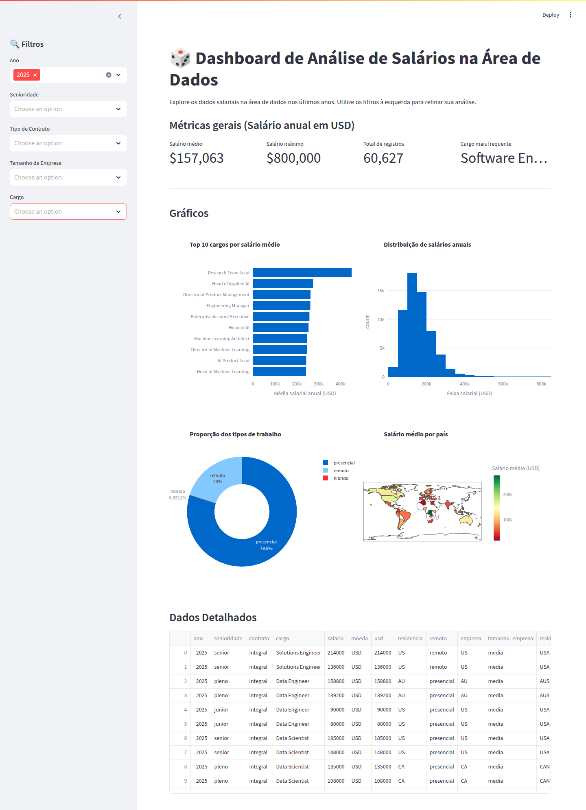

# 📊 Dashboard de Salários em Tecnologia

[](https://tech-salary-insights.streamlit.app/)
[](https://www.python.org/)
[](https://streamlit.io/)
[](https://pandas.pydata.org/)
[](https://plotly.com/)

Quanto se paga em tecnologia? O dashboard responde isso por **cargo, nível de senioridade e localização**, com filtros interativos sobre um dataset histórico e uma consulta complementar à API da Adzuna.

**🚀 Demo: [tech-salary-insights.streamlit.app](https://tech-salary-insights.streamlit.app)**



---

## Dados

O dashboard usa duas fontes independentes:

### 1. Dataset histórico (CSV)

- Arquivo `dados-imersao-final.csv`: **133.339 registros** (linhas de dados, sem o cabeçalho), de **2020 a 2025**, com 390 cargos distintos e 102 valores distintos de residência.
- Colunas: `ano`, `senioridade`, `contrato`, `cargo`, `salario`, `moeda`, `usd`, `residencia`, `remoto`, `empresa`, `tamanho_empresa`, `residencia_iso3`.
- `carregar_dados` (em `app.py`, com `@st.cache_data` **sem `ttl`**) lê primeiro o arquivo local ao lado do `app.py`. Se a leitura falhar (arquivo ausente, ilegível ou corrompido), registra um aviso no log e baixa a cópia remota de `https://raw.githubusercontent.com/vqrca/dashboard_salarios_dados/refs/heads/main/dados-imersao-final.csv`. O resultado fica em cache enquanto o processo do Streamlit estiver rodando.
- Se local e remoto falharem, o app mostra "Não foi possível carregar os dados no momento" e para (`st.stop()`).

### 2. API da Adzuna (seção "Mercado em Tempo Real")

- Endpoint `https://api.adzuna.com/v1/api/jobs/{pais}/history`, consultado com `months=12`.
- Escopo fixo: **6 cargos × 3 países = 18 combinações** (cargos em `CARGOS_DISPONIVEIS`, países em `PAISES_DISPONIVEIS`, ambos em `adzuna_api.py`). Países: Brasil (`br`), Estados Unidos (`us`) e Reino Unido (`gb`).
- A resposta traz um dicionário `month`; o código calcula **média, mínimo e máximo** dos valores mensais retornados e exibe na moeda local.
- A consulta só acontece quando o usuário clica em **Consultar**, nunca automaticamente no carregamento da página.

### Cache de 24h

- **Função:** `buscar_historico_salarial(cargo, pais_codigo)` em `adzuna_api.py`.
- **Decorator:** `@st.cache_data(ttl=86400)` (86.400 s = 24 h).
- **Onde fica:** no cache em memória do processo do Streamlit (não há arquivo nem banco). A chave do cache é o par `(cargo, pais_codigo)`; reiniciar o servidor zera o cache.
- Com no máximo 18 combinações e 24h de validade, o consumo fica previsível diante da cota gratuita da Adzuna (o comentário no código cita 1.000 chamadas/mês).

---

## Tratamento de falhas

Na seção da Adzuna, `buscar_historico_salarial` levanta `AdzunaAPIError` nos casos abaixo. O `app.py` captura a exceção e mostra um aviso com o motivo (`⚠️ Dados de mercado indisponíveis: ...`), sem derrubar o resto do dashboard. As mensagens exibidas nunca contêm URL nem credenciais.

| Situação | Mensagem ao usuário |
|---|---|
| `ADZUNA_APP_ID`/`ADZUNA_APP_KEY` ausentes | Credenciais da Adzuna não configuradas. |
| API **demora** (`timeout=10` s) | A Adzuna demorou demais para responder. |
| HTTP 401/403 | Credenciais da Adzuna inválidas ou sem permissão. |
| HTTP 429 | Limite de consultas da Adzuna atingido. Tente novamente mais tarde. |
| Outros erros HTTP (4xx/5xx) | A Adzuna está indisponível no momento. |
| Erro de conexão | Não foi possível conectar à Adzuna. |
| Resposta que não é JSON válido | Resposta inválida da Adzuna. |
| API devolve **vazio** (`month` ausente ou vazio) | A Adzuna não retornou dados para essa combinação. |

Os detalhes técnicos (status, corpo da resposta, cargo e país) vão para o log do servidor via `logging`. Falhas **não** entram no cache de 24h (coberto por teste), então o próximo clique em **Consultar** tenta a API de novo.

### Limitações conhecidas

- **Sem retry nem fallback:** uma falha é exibida como aviso; não há nova tentativa automática nem valor alternativo.
- **Falhas consomem cota:** como erros não são cacheados, cada clique após uma falha chama a API novamente.
- **A consulta bloqueia a interface** por até 10 s (o timeout) enquanto aguarda a Adzuna.
- **Rótulo da métrica:** a interface mostra "Salário médio anual", mas o código apenas faz a média dos valores mensais devolvidos pelo endpoint `history`; o significado exato da unidade depende da API e não é verificado no código.
- **Sem dados até selecionar um filtro:** é intencional; o dashboard não exibe nada enquanto nenhum filtro estiver ativo.
- **Os testes cobrem só a Adzuna:** o carregamento do CSV e os gráficos não têm testes automatizados.

---

## Arquitetura

```
Dashboard-Salarios/
├── app.py                    # Aplicação Streamlit
├── adzuna_api.py             # Cliente da API da Adzuna
├── dados-imersao-final.csv   # Dataset (lido primeiro; a cópia remota é o fallback)
├── tests/                    # Testes da integração com a Adzuna
├── docs/dashboard.png        # Captura de tela usada neste README
├── requirements.txt          # Dependências com versões fixas
├── .env.example              # Modelo das variáveis de ambiente (sem valores)
└── .gitignore
```

| Arquivo | Responsabilidade |
|---|---|
| `app.py` | Carrega o CSV (`carregar_dados`, local com fallback remoto), define os filtros da barra lateral (ano, senioridade, contrato, tamanho da empresa, cargo), calcula os KPIs, monta os gráficos Plotly e a tabela, e renderiza a seção da Adzuna com `st.session_state` para o resultado/erro. Nenhum dado é exibido até que pelo menos um filtro seja selecionado. |
| `adzuna_api.py` | Lê as credenciais do ambiente (com `python-dotenv`, se instalado), define o escopo fixo de cargos/países, faz a requisição, valida a resposta, aplica o cache de 24h e define `AdzunaAPIError`. |
| `tests/test_adzuna_api.py` | Testes (`unittest` + mocks, sem rede) de sucesso, cache, credenciais, timeout, HTTP, JSON inválido e resposta vazia. |
| `requirements.txt` | pandas, streamlit, plotly, requests, python-dotenv, pyarrow. |
| `.env.example` | Lista `ADZUNA_APP_ID` e `ADZUNA_APP_KEY` vazias. |

---

## Como rodar localmente

Requisitos: Python 3.9+ (exigido pelas versões fixas de Streamlit e Pandas). A internet só é necessária se o CSV local não puder ser lido ou para a seção da Adzuna.

```bash
git clone https://github.com/Acciolyy/Dashboard-Salarios.git
cd Dashboard-Salarios

python -m venv .venv
source .venv/bin/activate        # Windows (PowerShell): .venv\Scripts\Activate.ps1

pip install -r requirements.txt
```

### Chave da Adzuna (opcional)

Só a seção "Mercado em Tempo Real" depende dela. Sem as variáveis, o resto do dashboard funciona e essa seção mostra o aviso de indisponibilidade.

```bash
cp .env.example .env
```

Preencha o `.env` com as credenciais obtidas em [developer.adzuna.com](https://developer.adzuna.com/):

```
ADZUNA_APP_ID=
ADZUNA_APP_KEY=
```

Também é possível exportar as duas variáveis diretamente no ambiente. O `.env` está no `.gitignore`; **nunca o versione**.

### Testes

```bash
python -m unittest discover -s tests
```

### Executar

```bash
streamlit run app.py
```

Acesse `http://localhost:8501`.

---

## Stack

- **Python**
- **Pandas**: carga e filtragem dos dados
- **Plotly** (`plotly.express`): gráficos
- **Streamlit**: interface web e cache (`st.cache_data`)
- **API Adzuna** (via `requests`): dados de mercado recentes

---

Desenvolvido por **Thiago Viriato Accioly**.
